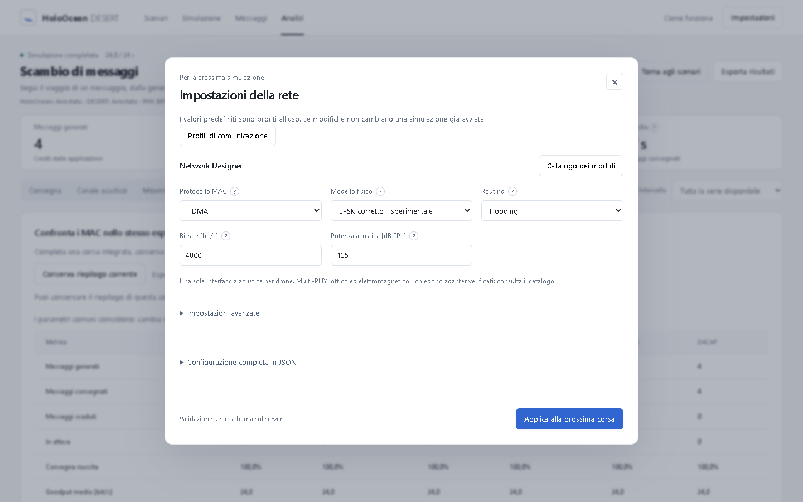

# HoloOcean–DESERT

A Python library and web laboratory for simulating communication between
underwater vehicles. [HoloOcean](https://byu-holoocean.github.io/holoocean-docs/)
2.3 provides the environment, vehicle dynamics and sensors;
[DESERT Underwater](https://desert-underwater.dei.unipd.it/) 4.0 on NS-MIRACLE
executes the network: PHY, propagation, interference, MAC, routing and native
traffic generators. The two simulators share one synchronised timeline. No
network behaviour is re-implemented in Python.

The library can be used on its own, attached to an existing HoloOcean
program, or through the browser-based laboratory, which is a client of the
same API.

## Architecture

```
 your Python code / dashboard (FastAPI + JS)
            │  holo_desert public API: NetworkSession · HoloOceanLink · ManagedSimulation
            ▼
 orchestration: one logical clock (tick = 1/physics_hz), message queues, telemetry
     │                                         │  TCP, newline-framed commands/events
     ▼                                         ▼
 HoloOcean 2.3 (host, GPU)              Docker: DESERT 4.0 / NS-MIRACLE
 vehicles, physics, own-pose sensors    Stack Builder (whitelist) → Tcl adapters
                                        → native PHY/MAC/routing/apps + C++ bridge
```

At every tick the measured vehicle poses are applied in DESERT, pending
messages are injected, the NS scheduler runs to the same simulated time and
its receptions are delivered back with their native timestamps. HoloOcean
supplies geometry only; applications never receive other vehicles' poses from
the library.

## What is supported

Status from executed tests (details and blockers: [capability matrix](docs/capabilities.md)).

| Area | Operational | Experimental (verified) | Not integrated |
|---|---|---|---|
| MAC | ALOHA, CSMA-ALOHA, TDMA, TDMA Frame, CSMA/CA, DACAP, TokenBus, CS-Burst, Ranging-TokenBus | — | Polling, T-LOHI, ALOHA-Q, UFetch |
| Routing | Static (multi-hop), Flooding, SUN | — | ICRP, Position-Based |
| PHY / channel | BPSK + analytic Underwater/Thorp + MIV; WOSS/Bellhop (synthetic SSP) | corrected BPSK, optical, electromagnetic | OFDM, HMM |
| Interfaces | one interface per vehicle | multi-PHY with native switching (engine-level tests only) | hybrid acoustic/optical |
| Traffic & measurement | Python generators, JSON/binary messages, native UW/CBR and UW/VBR, native ranging (TokenBus) | — | ranging TDMA/TDOA |
| Hardware modems | — | — | drivers present in DESERT, no hardware validation |

## Requirements

* Python 3.10–3.12, Docker (Desktop on Windows, Engine + Compose on Linux).
* For vehicle simulation: HoloOcean 2.3.0 with the Ocean package and a GPU
  able to run it. Co-simulation verified on Windows 11; on Ubuntu 24.04 installation, unit and
  browser tests are verified, HoloOcean rendering is not.
* The DESERT engine image is built locally from the official
  `uwsignet/desert:4.0.0` image pinned by digest (first build downloads ~1.4 GB).

## Quick start

```bash
git clone https://github.com/AndreaBedei1/HoloWithDesertCommunications.git
cd HoloWithDesertCommunications
python -m venv .venv
.venv/bin/pip install -e ".[dashboard]"      # Windows: .venv\Scripts\pip ...
.venv/bin/holo-desert engine up              # build and start the DESERT engine
.venv/bin/holo-desert doctor                 # or: doctor --library-only
```

Windows scripted setup including HoloOcean: `scripts/setup.ps1`; Ubuntu:
`scripts/setup.sh`. As a dependency of another project:
`pip install "holoocean-desert @ git+https://github.com/AndreaBedei1/HoloWithDesertCommunications.git"`.
The library core needs only PyYAML and pydantic; `[dashboard]` adds FastAPI and
uvicorn. See [installation](docs/installation.md).

## Using the library

Send and receive through DESERT without HoloOcean:

```python
from holo_desert import NetworkSession, Scenario, NodeConfig, Network

scenario = Scenario(
    name="hello", description="two nodes, TDMA",
    nodes=[NodeConfig(id="auv_01", position=(0, 0, -20)),
           NodeConfig(id="auv_02", position=(40, 0, -20))],
    network=Network.model_validate({"mac": {"protocol": "tdma"}}))

with NetworkSession(scenario) as net:
    net.node("auv_02").on_receive(lambda d: print(d.network_time, d.message.json()))
    net.node("auv_01").send_json("auv_02", {"cmd": "surface"})
    net.run_until(10)                       # seconds of simulated time
    print(net.summary()["received"])
```

Attach to a HoloOcean environment your program already controls:

```python
link = HoloOceanLink(net, {"leader": "auv_01", "follower": "auv_02"}, ticks_per_sec=30)
link.attach(env.reset())
while mission_running:
    env.act("leader", command)              # you keep control of the vehicles
    link.sync(env.tick())                   # DESERT advances over the same tick
```

Run a complete scenario the way the dashboard does:

```python
from holo_desert import ManagedSimulation
with ManagedSimulation("e03_mobility", realtime=False) as sim:
    print(sim.run())
    sim.export("e03.zip")
```

Runnable programs: [`examples/`](examples) (standalone, attached, managed,
multi-PHY and an install check that imports only the public API). The
[API reference](docs/api.md) documents the clock model, operation order,
callbacks, session life cycle and error handling.

## Web laboratory

```bash
holo-desert dashboard            # http://127.0.0.1:8000
```

Choose a scenario, start it, follow vehicles and messages on the map and
timeline, then open *Analisi* for metrics and comparisons. *Impostazioni →
Network Designer* selects MAC, PHY and routing with contextual help for each
parameter; *I miei scenari* edits vehicles, waypoints, flows and routes and
imports/exports YAML. The interface is in Italian.



## Scenarios

| ID | Scenario | What it shows |
|---|---|---|
| E01 | Message exchange | request/reply between two vehicles |
| E02 | Multi-node | four vehicles on one channel |
| E03 | Mobility | delivery while range grows and shrinks |
| E04 | Congestion | queues, interference, MAC comparison |
| E05 | Multi-hop | static relay A → B → C where the direct link fails |
| E06 | Coordination | heartbeat-driven HOLD/PROCEED, outage by PHY power |
| e07 | Ranging-TokenBus | native distance estimates between three vehicles |
| e08 | WOSS/Bellhop | moving receiver in a synthetic sound-speed profile |
| e09 | SUN convergecast | native route discovery through relays to a sink |

E01–E06 are the original reference experiments and are kept unchanged; the
demos live in `src/holo_desert/resources/demos`. `holo-desert run e03_mobility
--fast --no-dashboard` runs one from the command line.

## Results and metrics

Each run records the effective configuration, every engine event
(`events.jsonl`) and one row per message (`packets.csv`), exportable as a ZIP.
Metrics distinguish delivery over resolved vs generated messages, goodput,
end-to-end latency, transmission airtime and propagation, PHY reception
outcomes and MAC queue/statistics. Provenance includes the DESERT base digest
and source commit, the engine fingerprint, applied patches and RNG substream.
See [telemetry and reproducibility](docs/telemetry-and-reproducibility.md).

## Documentation

[Index](docs/index.md) · [API](docs/api.md) · [Capabilities](docs/capabilities.md) ·
[Stack configuration and YAML](docs/stack-configuration.md) ·
[Dashboard](docs/dashboard.md) · [Developer guide](docs/developer-guide.md) ·
[Troubleshooting](docs/troubleshooting.md) · [Limitations](docs/limitations.md) ·
[Validation records](docs/evidence/README.md)

## Tests

```bash
pytest -m "not desert and not holoocean"     # unit tests, no engines
DESERT_PORT=5555 pytest -m "desert and not holoocean"   # real DESERT engine
pytest -m holoocean                          # HoloOcean co-simulation (GPU)
npm --prefix tests/frontend ci && npm --prefix tests/frontend test -- --config playwright.config.cjs
```

## Limitations

The analytic channel holds geometry constant for one physics tick and has no
Doppler; HoloOcean obstacles and seabed are not converted into acoustic
bathymetry; application messages are unicast; one MAC per network. The BPSK
correction, optical and EM chains are experimental and none of the models is
calibrated against a specific modem or sea trial. Full list:
[limitations](docs/limitations.md).

## License and attribution

Project code: MIT ([LICENSE](LICENSE)). HoloOcean (BYU FRoSt Lab), DESERT
Underwater (University of Padova SIGNET), NS-2/NS-MIRACLE and WOSS keep their
own licenses; their binaries, Docker images, the Ocean package, virtual
environments and simulation results are not distributed with this repository.
