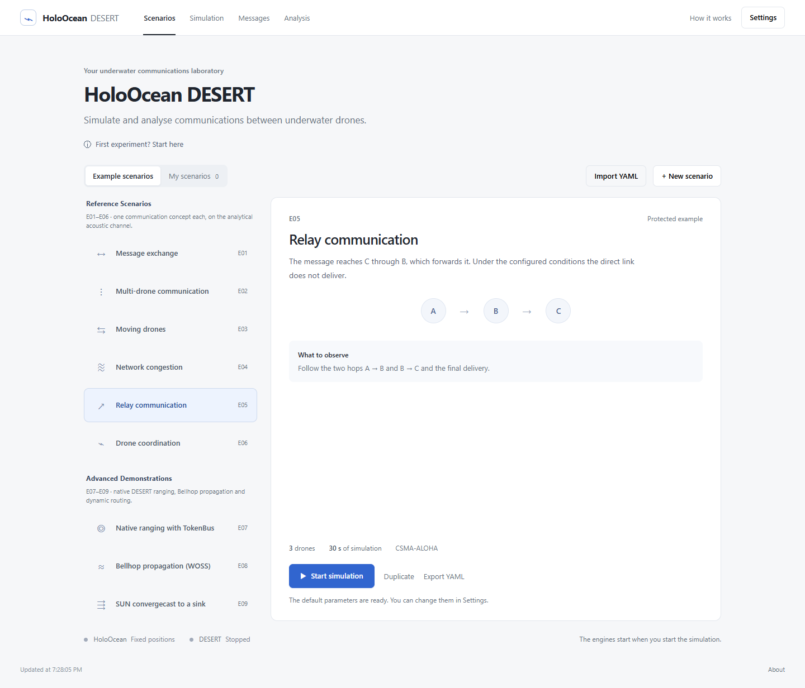
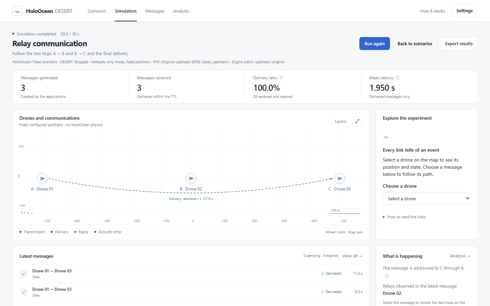
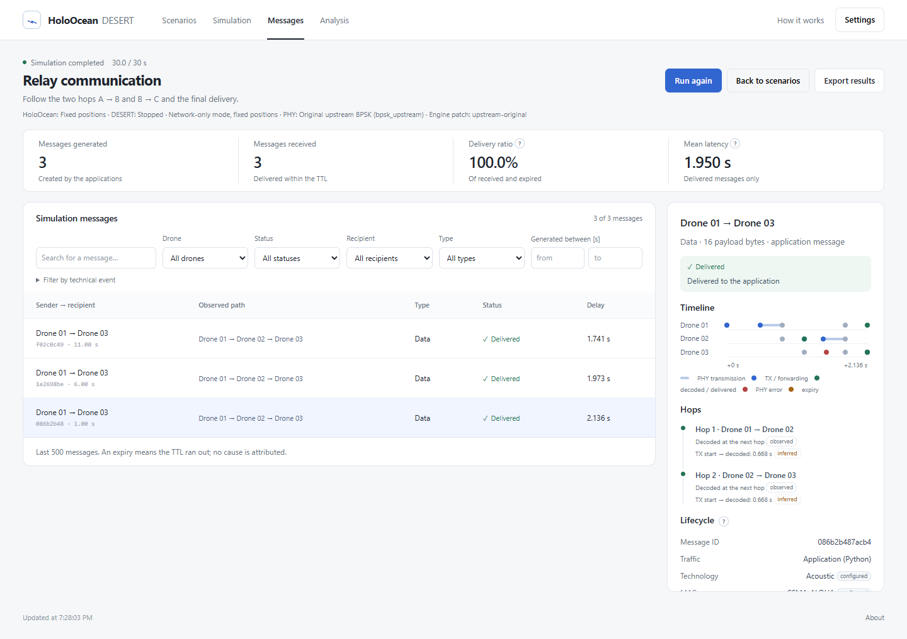
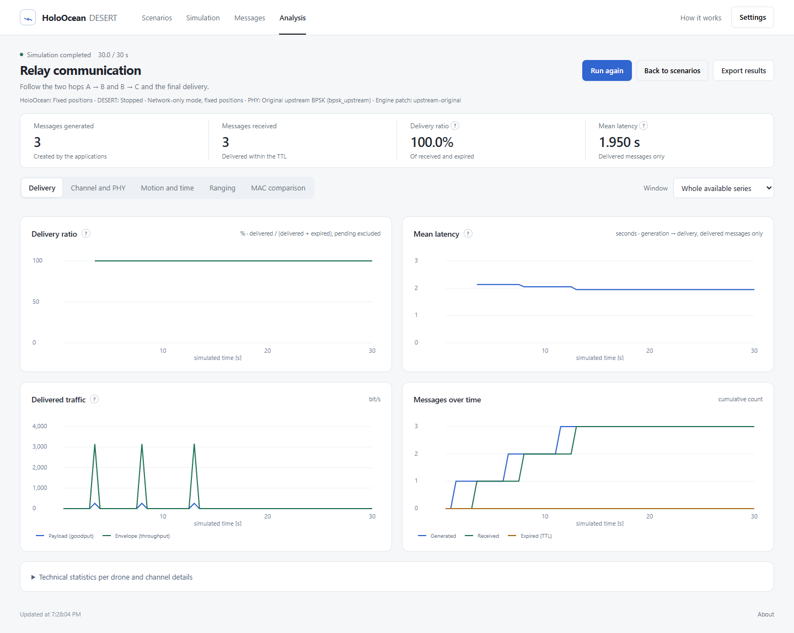
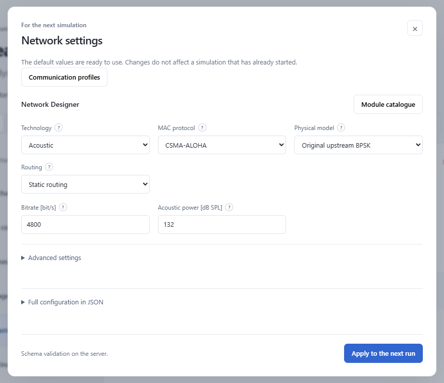

# HoloOcean–DESERT

[](https://github.com/AndreaBedei1/HoloWithDesertCommunications/actions/workflows/tests.yml)


A Python library and web laboratory for simulating communication between
underwater vehicles. [HoloOcean](https://byu-holoocean.github.io/holoocean-docs/)
2.3 provides the environment, vehicle dynamics and sensors;
[DESERT Underwater](https://desert-underwater.dei.unipd.it/) 4.0 on NS-MIRACLE
executes the network: PHY, propagation, interference, MAC, routing and native
traffic generators. The two simulators share one synchronised timeline. No
network behaviour is re-implemented in Python.

The library can be used on its own, attached to an existing HoloOcean
program, or through the browser-based laboratory, which is a client of the
same API.

## Architecture

```
 your Python code / dashboard (FastAPI + JS)
            │  holo_desert public API: NetworkSession · HoloOceanLink · ManagedSimulation
            ▼
 orchestration: one logical clock (tick = 1/physics_hz), message queues, telemetry
     │                                         │  TCP, newline-framed commands/events
     ▼                                         ▼
 HoloOcean 2.3 (host, GPU)              Docker: DESERT 4.0 / NS-MIRACLE
 vehicles, physics, own-pose sensors    Stack Builder (whitelist) → Tcl adapters
                                        → native PHY/MAC/routing/apps + C++ bridge
```

At every tick the measured vehicle poses are applied in DESERT, pending
messages are injected, the NS scheduler runs to the same simulated time and
its receptions are delivered back with their native timestamps. HoloOcean
supplies geometry only; applications never receive other vehicles' poses from
the library.

## What is supported

Status from executed tests (details and blockers: [capability matrix](docs/capabilities.md)).

| Area | Operational | Experimental (verified) | Not integrated |
|---|---|---|---|
| MAC | ALOHA, CSMA-ALOHA, TDMA, TDMA Frame, CSMA/CA, DACAP, TokenBus, CS-Burst, Ranging-TokenBus, Ranging-TDMA | — | Polling, T-LOHI, ALOHA-Q, UFetch |
| Routing | Static (multi-hop), Flooding, SUN | Position-Based (static anchors, own-fix vehicles, no ground truth) | ICRP |
| PHY / channel | BPSK + analytic Underwater/Thorp + MIV; WOSS/Bellhop (synthetic SSP) | corrected BPSK, optical, electromagnetic | OFDM, HMM, UW/PHYSICAL, HERMES, AHOI, Rogers (candidates and blockers in the capability matrix) |
| Interfaces | one interface per vehicle | multi-PHY: 2–3 acoustic or optical interfaces, native manual or received-power switching | — |
| Traffic & measurement | Python generators, JSON/binary messages, native UW/CBR and UW/VBR, native ranging (TokenBus, TDMA) | — | ranging TDOA |
| Hardware modems | — | — | drivers present in DESERT, no hardware validation |

## Requirements

* Python 3.10–3.12, Docker (Desktop on Windows, Engine + Compose on Linux).
* For vehicle simulation: HoloOcean 2.3.0 with the Ocean package and a GPU
  able to run it. Co-simulation verified on Windows 11; on Ubuntu 24.04 installation, unit and
  browser tests are verified, HoloOcean rendering is not.
* The DESERT engine image is built locally from the official
  `uwsignet/desert:4.0.0` image pinned by digest (first build downloads ~1.4 GB).

## Quick start

```bash
git clone https://github.com/AndreaBedei1/HoloWithDesertCommunications.git
cd HoloWithDesertCommunications
python -m venv .venv
.venv/bin/pip install -e ".[dashboard]"      # Windows: .venv\Scripts\pip ...
.venv/bin/holo-desert engine up              # build and start the DESERT engine
.venv/bin/holo-desert doctor                 # or: doctor --library-only
```

Windows scripted setup including HoloOcean: `scripts/setup.ps1`; Ubuntu:
`scripts/setup.sh`. As a dependency of another project:
`pip install "holoocean-desert @ git+https://github.com/AndreaBedei1/HoloWithDesertCommunications.git"`.
The library core needs only PyYAML and pydantic; `[dashboard]` adds FastAPI and
uvicorn. See [installation](docs/installation.md).

## Using the library

Send and receive through DESERT without HoloOcean:

```python
from holo_desert import NetworkSession, Scenario, NodeConfig, Network

scenario = Scenario(
    name="hello", description="two nodes, TDMA",
    nodes=[NodeConfig(id="auv_01", position=(0, 0, -20)),
           NodeConfig(id="auv_02", position=(40, 0, -20))],
    network=Network.model_validate({"mac": {"protocol": "tdma"}}))

with NetworkSession(scenario) as net:
    net.node("auv_02").on_receive(lambda d: print(d.network_time, d.message.json()))
    net.node("auv_01").send_json("auv_02", {"cmd": "surface"})
    net.run_until(10)                       # seconds of simulated time
    print(net.summary()["received"])
```

Attach to a HoloOcean environment your program already controls:

```python
link = HoloOceanLink(net, {"leader": "auv_01", "follower": "auv_02"}, ticks_per_sec=30)
link.attach(env.reset())
while mission_running:
    env.act("leader", command)              # you keep control of the vehicles
    link.sync(env.tick())                   # DESERT advances over the same tick
```

Run a complete scenario the way the dashboard does:

```python
from holo_desert import ManagedSimulation
with ManagedSimulation("e03_mobility", realtime=False) as sim:
    print(sim.run())
    sim.export("e03.zip")
```

Runnable programs: [`examples/`](examples) (standalone, attached, managed,
multi-PHY, hybrid acoustic/optical, Position-Based Routing and an install
check that imports only the public API). The
[API reference](docs/api.md) documents the clock model, operation order,
callbacks, session life cycle and error handling.

## Web laboratory

```bash
holo-desert dashboard            # http://127.0.0.1:8000
```

Choose a scenario, start it, follow vehicles and messages on the map and
timeline, then open *Analysis* for metrics and comparisons. *Messages* lists
every message with filters (drone, status, recipient, type, interface
for multi-PHY, generation time range); selecting one opens its lifecycle:
final status, a per-drone timeline, per-hop outcomes, relays and the drones
that decoded or overheard it, each fact tagged as observed, inferred or
configured, with its relay path drawn on the map. *Settings → Network
Designer* selects medium (acoustic, optical, EM), MAC, PHY, routing, WOSS
with its sound-speed profile, acoustic or optical multi-PHY interfaces,
Position-Based Routing anchors and native CBR/VBR generators, with contextual
help (meaning, unit, default, constraints) for each parameter and a reason
for every unavailable option. Its menus list only operational modules; the
complete inventory is in the *Module catalogue*. *Analysis → Interfaces*
shows which interface each transmission used and when the controller
switched; *Analysis → Ranging* compares native distance estimates with the
HoloOcean geometry; *My scenarios* edits vehicles, waypoints, flows and
routes and imports/exports YAML. The interface is in English.

Screenshots of release 1.1.0 from real DESERT runs (E05, network-only mode):







## Scenarios

Nine scenarios are bundled, shown on the dashboard home page in two groups.

**Reference Scenarios** (E01–E06, `src/holo_desert/resources/examples`): one
communication concept each, on the analytic acoustic channel.

| ID | Title | What it shows |
|---|---|---|
| `e01_chat` | Message exchange | request/reply between two stationary vehicles |
| `e02_multi_node` | Multi-drone communication | four vehicles on one channel |
| `e03_mobility` | Moving drones | delivery while range grows and shrinks |
| `e04_congestion` | Network congestion | queues, interference, MAC comparison |
| `e05_multihop` | Relay communication | static relay A → B → C where the direct link fails |
| `e06_coordination` | Drone coordination | heartbeat-driven HOLD/PROCEED, outage by PHY power |

**Advanced Demonstrations** (E07–E09, `src/holo_desert/resources/demos`):
native DESERT ranging, Bellhop propagation and dynamic routing.

| ID | Title | What it shows |
|---|---|---|
| `e07_ranging_tokenbus` | Native ranging with TokenBus | native distance estimates between three vehicles |
| `e08_woss` | Bellhop propagation (WOSS) | moving receiver in a synthetic sound-speed profile |
| `e09_sun_convergecast` | SUN convergecast to a sink | native route discovery through relays to a sink |

E01–E06 are the original reference experiments and are kept unchanged.
`holo-desert examples` lists all nine with their group; any of them runs by ID
from the command line (`holo-desert run e08_woss`, or `holo-desert run
e03_mobility --fast --no-dashboard`), from Python
(`ManagedSimulation("e09_sun_convergecast")`) or from the dashboard home page.
See [scenarios](docs/scenarios.md).

## Results and metrics

Each run records the effective configuration, every engine event
(`events.jsonl`) and one row per message (`packets.csv`), exportable as a ZIP.
Metrics distinguish delivery over resolved vs generated messages, goodput,
end-to-end latency, transmission airtime and propagation, PHY reception
outcomes and MAC queue/statistics. Provenance includes the DESERT base digest
and source commit, the engine fingerprint, applied patches, RNG substream and
the values read back from the native DESERT objects at start (`native_bindings`).
See [telemetry and reproducibility](docs/telemetry-and-reproducibility.md) and
the [reproducibility guide](docs/reproducibility.md) (pinned versions, steps,
expected E01–E06 results).

## Documentation

[Index](docs/index.md) · [API](docs/api.md) · [Capabilities](docs/capabilities.md) ·
[Stack configuration and YAML](docs/stack-configuration.md) ·
[Dashboard](docs/dashboard.md) · [Developer guide](docs/developer-guide.md) ·
[Troubleshooting](docs/troubleshooting.md) · [Limitations](docs/limitations.md) ·
[Reproducibility](docs/reproducibility.md) · [Validation records](docs/evidence/README.md)

## Tests

```bash
pytest -m "not desert and not holoocean"     # unit tests, no engines
DESERT_PORT=5555 pytest -m "desert and not holoocean"   # real DESERT engine
pytest -m holoocean                          # HoloOcean co-simulation (GPU)
npm --prefix tests/frontend ci && npm --prefix tests/frontend test -- --config playwright.config.cjs
```

## Limitations

The analytic channel holds geometry constant for one physics tick and has no
Doppler; HoloOcean obstacles and seabed are not converted into acoustic
bathymetry; application messages are unicast; one MAC per network. The BPSK
correction, optical and EM chains are experimental and none of the models is
calibrated against a specific modem or sea trial. The message inspector shows
only what DESERT and the telemetry observe (it attributes no collisions), and
recorded runs cannot be replayed. Full list:
[limitations](docs/limitations.md).

## How to cite

Citation metadata are in [`CITATION.cff`](CITATION.cff) (GitHub shows a
"Cite this repository" entry). Please also cite HoloOcean (Potokar et al.,
ICRA 2022) and DESERT Underwater (Campagnaro et al., UComms 2016), listed in the
same file, and state the commit and engine fingerprint you used.

## License and attribution

Project code: MIT ([LICENSE](LICENSE)). HoloOcean (BYU FRoSt Lab), DESERT
Underwater (University of Padova SIGNET), NS-2/NS-MIRACLE and WOSS keep their
own licenses; their binaries, Docker images, the Ocean package, virtual
environments and simulation results are not distributed with this repository.
