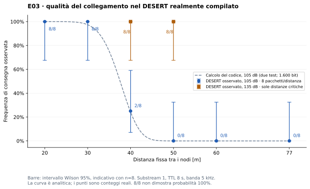

# E03 Mobility: diagnosi delle mancate consegne

20 ottobre 2026. Repository esaminato: `83affa412961ef9056f3b696207552603ae83737`.

## Conclusione

La sola nuova corsa E03, originale e completa, riproduce **45 generati, 22
consegnati, 23 scaduti**. I **22 messaggi generati a 13, 15, …, 55 s** falliscono
tutti dopo avere effettivamente trasmesso: **21 `noise_error` e 1
`interference_error` del secondo test PHY**. L'altra perdita è il messaggio
generato a 9 s, anch'esso nel secondo test. Nessun arrivo tardivo, nessuna
perdita indeterminata in questa corsa, nessuno scarto autonomo del MAC.

La causa dominante è il BER del collegamento a 105 dB con penalizzazione RX
di −10 dB, applicato a frame di **1.600/1.608 bit**, non ai soli 16 byte di
payload. **È presente anche un difetto implementativo upstream:** il PHY
ritesta il rumore nel ramo chiamato «interferenza» anche quando la potenza
interferente è zero. Questo peggiora la transizione e rende ingannevole il
nome di quel contatore. Non è congestione e non è il TTL a impedire la
decodifica. Nessuna correzione o ritaratura è stata applicata.

## 1. Identità effettiva e metodo

Prima di inviare pacchetti sono stati letti i sorgenti **dentro il container**,
risolte le dipendenze con `ldd`, esaminati i simboli e il disassemblato delle
librerie caricate, interrogati gli oggetti Tcl costruiti dal bridge originale.
Un'estensione diagnostica temporanea ha richiamato i metodi compilati
`getPER()`/`getTxPower()` e osservato i segmenti MIV delegando senza modifiche
all'implementazione originale: nessun sorteggio RNG aggiuntivo, nessuna
decisione di ricezione sostituita. Nelle prove statiche aggiunge solo output;
la corsa HoloOcean E03 usa il bridge originale, senza questa estensione.

Identità verificata:

- Base: `uwsignet/desert:4.0.0@sha256:59c734d2980de64e4b36429c3fb4a60aceb1cb7efc5f9d605f9b7781fbc51ca6`. I layer della base coincidono con il prefisso dei layer dell'immagine derivata.
- Immagine in uso: `sha256:26c7aa746a4af936b0234d4b5c5ff7548433fa9f46c21f859a16a689106b723b` (`holo-desert-engine:4.0.0-v1`).
- Commit DESERT nel container, working tree Git pulito: `12203f3cdba7d85bac78074d1f2ccfddbfb08021`. NS-MIRACLE proviene da `.unpacked_folder/nsmiracle-2.0.0`, NS da `ns-2.34`; non gli attribuisco un commit Git separato non disponibile.
- `bridge.cc`, `bridge.tcl` e `server.py` nel container hanno SHA256 identici ai file del repository. I moduli realmente caricati sono `libUwmStd`, `libmphy`, `libuwcsmaaloha` e il bridge esterno, non `libuwphysical` o WOSS.

SHA256 dei binari effettivi in `DESERT_buildCopy_LOCAL/lib` (bridge in `/opt/holo`):

| File | SHA256 |
|---|---|
| `libholobridge.so` | `0957890637785a3f306f6cc1a736a956cf0b08dbeab1d44c0c2cd8f1c5614607` |
| `libUwmStd.so.0.0.0` | `ac8b43843dd6a123c8a9e67a2cee02ce4c2f2502a3eabb7987ae0035d7b8d18c` |
| `libmphy.so.0.0.0` | `46b3e1795cf1d03158d594d96b8ffd37dba6827161f0d2d63a53ace368eb4f43` |
| `libuwcsmaaloha.so.0.0.0` | `5aad4c6cc0f11b45e417938bd1cb33cc519d149a64d5b725a901952df4d8f4f3` |

La chiamata nativa con SNR lineare 100 e 1.600 bit restituisce PER
`0,006176233312301216`: coincide con BPSK e la penalizzazione −10 dB.
L'osservazione dei frame statici conferma `Pt=31622776601,6838` e
`Pn=850498,163812319`. Tutti i **45 SNR della corsa mobile** coincidono entro
`10⁻⁸ dB` con il modello e le posizioni effettivamente applicate a NS.

Telemetria precedente: i riepiloghi locali riportavano già 45/22/23, mentre
lo snapshot UI E03 si fermava a 40,2 s. Mancava la storia completa per
attribuire ogni perdita: è stata quindi eseguita **una sola E03 integrata di
100 s**, senza override YAML, `realtime=true`, HoloOcean 2.3, fisica 30 Hz,
substream originale 1 e viewport nascosto. Seguono nove sessioni statiche
brevi (72 pacchetti complessivi), nessuna campagna multi-seed.
ID della nuova corsa integrata: `043ac210-afbf-4f75-a9e7-ef2bea3fb119`.

## 2. Modello acustico effettivo

I percorsi `U/...` qui sotto sono relativi a
`/home/DESERT_Underwater/DESERT_Framework/.unpacked_folder/nsmiracle-2.0.0/`;
`D/...` a `/home/DESERT_Underwater/DESERT_Framework/DESERT/`.
Sono riferimenti alla copia ispezionata nel container, non a un branch pubblico.

**Attenuazione.** `U/uwm/underwater-mpropagation.cc:85` chiama
`uwlib_AInv(r/1000, k, f/1000)`, definita in `U/uwm/uwlib.c:38`:

```text
alpha(f) = 0.11 f²/(1+f²) + 44 f²/(4100+f²) + 2.75e-4 f² + 0.003
TL(r,f) = 10 k log10(r) + alpha(f) r/1000
G = min(1, 10^(-TL/10))                 r in metri, f in kHz
```

`practicalSpreading_=1,75` **letto dall'oggetto**, non 1,5. A 25 kHz,
`alpha=6,1048051 dB/km`: a 77 m l'assorbimento è solo 0,47007 dB,
contro 33,01359 dB di spreading. Non c'è un taglio geometrico di portata.
La vecchia `Underwater::getAttenuation` commentata nel percorso di propagazione
non è la funzione chiamata; nemmeno `uwlib_SNR()` con spreading 1,5 e banda
ottimizzata descrive E03. Le ottimizzazioni SPL/frequenza/banda sono tutte 0.
`PER_target_=0,01` è un obiettivo dell'ottimizzazione SPL disabilitata,
non una PER imposta ai ricevitori. Non sono attivi WOSS, Rayleigh, shadowing
o un modello di multipath variabile con questa configurazione.

**Propagazione.** `propSpeed_=1500 m/s` letto dal canale.
`U/uwm/underwater.cc:324` sovrascrive il calcolo termico/depth quando questo
valore è positivo: qui `tau=r/1500`, senza ritardo aggiuntivo di multipath.
Verificato anche `t_RXinizio−t_TX = distanza_TX/1500` su tutti i pacchetti.

**Rumore.** Shipping `s=0,5`, vento `w=0 m/s`, frequenza centrale 25 kHz,
banda rettangolare **5.000 Hz** (22,5–27,5 kHz). `U/uwm/underwater.cc:150`
somma in scala lineare quattro densità, espresse in dB prima della somma:

```text
Nt  = 17 − 30 log10(f)
Ns  = 40 + 20(s−0.5) + 26 log10(f) − 60 log10(f+0.03)
Nw  = 50 + 7.5 sqrt(w) + 20 log10(f) − 40 log10(f+0.4)
Nth = −15 + 20 log10(f)
Pn  = B sum(10^(Ni/10))
```

Le quattro componenti a 25 kHz valgono rispettivamente −24,9382, −7,5612,
21,7655 e 12,9588 dB. Il codice `U/uwm/underwater-bpsk.cc:91` considera
la densità **piatta al valore centrale**, non integra queste curve sulla
banda: PSD totale circa 22,30703 dB/Hz, `Pn=850498,1638` in unità lineari
acustiche; livello integrato **59,296734 dB**. Non usa il rumore termico
generico `NoiseSPD_` della classe MPhy né un rumore casuale aggiunto al segnale.

**Potenza e SNR.** `U/uwm/underwater-bpsk.cc:147–186` restituisce
`Pt=10^(MaxTxSPL_dB_/10)=3,16227766×10¹⁰` per 105 dB. È un valore normalizzato
di pressione quadratica in µPa², **non 105 W né 3,16×10¹⁰ W**; la pressione
rms corrispondente è circa 0,177828 Pa a riferimento 1 µPa. Il vecchio campo
`TxPower_=5×10⁹` è ancora leggibile ma non determina `getTxPower()` in questo
percorso. La conversione energetica in watt di `consumedEnergy()` è separata
dal calcolo del collegamento. A 135 dB Pt aumenta di 1.000 volte.

`U/mphy/mphy.cc:381` calcola `Pr=Pt × G × overlap × guadagni antenna/correlazione`;
qui maschere identiche, antenne/correlazione non impostate, fattori unitari.
Lo SNR esposto è **10 log10(Pr/Pn)**: non include la penalità né l'interferenza.

**Acquisizione e BER.** La soglia letta è **0 dB**, con confronto strettamente
`SNR > soglia` (`U/mphy/bpsk.cc:182–219`), ricevitore libero e modulazione
compatibile. Tutte le 45 ricezioni iniziano sincronizzate: nessuna
`not_synchronized`, `below_acquisition_threshold`, occupazione RX/TX o
modulazione errata. In seguito:

```text
gamma = (Pr/Pn) × 10^(-10/10)            penalità RX letta: −10 dB
BER = 0.5 erfc(sqrt(gamma))
PER1(L) = 1 − (1−BER)^L
```

Sono le funzioni `U/uwm/underwater-bpsk.cc:286` e `U/mphy/bpsk.cc:400`.
Il codice non moltiplica gamma per B/bitrate per convertirla ulteriormente
in Eb/N0. La durata è `8 × ch->size()/4800`.

**Interferenza e secondo test.** Il primo sorteggio verifica PER1(L).
Solo se passa, `U/mphy/bpsk.cc:263–279` esegue nuovi sorteggi usando
`Pr/(Pn+I_chunk)`. MIV (`U/mphy/interference_miv.cc:191–199`) inserisce anche
il segmento iniziale **I=0**. Nel caso isolato osservato il segmento dura
`durata−1 µs`; `int(durata_chunk×4800)=L−1`. Pertanto:

```text
P(consegna | nessun interferente) = (1−BER)^L × (1−BER)^(L−1)
PER_impl = 1 − (1−BER)^(2L−1)
```

Il secondo errore incrementa `errorPktsInterf` pur essendo un ulteriore test
del rumore. Le prove a 40 m osservano tre errori di questo tipo e **nessun
segmento con I>0**. In E03 nessun frame si sovrappone ad altri, e il ricevitore
non trasmette mai. Non si può quindi descriverli come collisioni reali.

## 3. Previsione analitica e prove statiche

Ipotesi della tabella: 105 dB, 25 kHz, B=5 kHz, k=1,75, s=0,5, w=0,
penalità −10 dB, nodi fermi, nessun interferente, L=1.600 bit. I valori
`PER1` e `PER_impl` sono **probabilità analitiche**, non frequenze misurate.
Gli ultimi tre messaggi della sequenza statica hanno L=1.608 per la cifra
aggiuntiva del timestamp; le probabilità cambiano leggermente. Valori
arrotondati vicini a 1 non significano un limite di portata deterministico.
L'elevamento a potenza assume errori di bit indipendenti; la combinazione
dei due test assume sorteggi uniformi indipendenti, come nel modello RNG.

| Distanza m | Propagazione ms | TL dB | SNR osservabile dB | SNR dopo penalità dB | BER | PER1 | PER_impl |
|---:|---:|---:|---:|---:|---:|---:|---:|
| 20 | 13.333 | 22.8901 | 22.8131 | 12.8131 | 3.1524e-10 | 5.043842489e-07 | 1.008453004e-06 |
| 30 | 20.000 | 26.0328 | 19.6705 | 9.6705 | 8.32433e-06 | 0.01323067763 | 0.02627819885 |
| 40 | 26.667 | 28.2802 | 17.4230 | 7.4230 | 0.000443618 | 0.5083292248 | 0.758152561 |
| 50 | 33.333 | 30.0372 | 15.6661 | 5.6661 | 0.00331081 | 0.9950386481 | 0.9999753032 |
| 60 | 40.000 | 31.4839 | 14.2193 | 4.2193 | 0.0107611 | 0.9999999697 | 1 |
| 77 | 51.333 | 33.4837 | 12.2196 | 2.2196 | 0.0339268 | 1 | 1 |

Otto pacchetti per sessione, generati a 1, 3, …, 15 s: stessi ID, timestamp,
envelope JSON/base64, payload `x×16`, parametri E03 e substream 1. La sola
variabile nelle sei sessioni iniziali è la distanza. Envelope 196/197 byte,
header UDP 4 byte, header MAC 0: 200/201 byte nel calcolo BER e durata.
Il traffico non è stato ridotto a 16 byte sul canale. Ogni sessione è
osservata fino a 50 s; nessun secondo substream necessario per questa diagnosi.
Le sessioni usano direttamente il vero processo NS e lo stesso Tcl del bridge,
non un modello Python e non la fixture cinematica HoloOcean.

| Distanza m | SPL dB | TTL s | SNR misurato dB | Consegne | PER empirico | noise_error | interference_error | Non sincronizzati |
|---:|---:|---:|---:|---:|---:|---:|---:|---:|
| 20 | 105 | 8 | 22.8131 | 8/8 | 0.000 | 0 | 0 | 0 |
| 30 | 105 | 8 | 19.6705 | 8/8 | 0.000 | 0 | 0 | 0 |
| 40 | 105 | 8 | 17.4230 | 2/8 | 0.750 | 3 | 3 | 0 |
| 50 | 105 | 8 | 15.6661 | 0/8 | 1.000 | 8 | 0 | 0 |
| 60 | 105 | 8 | 14.2193 | 0/8 | 1.000 | 8 | 0 | 0 |
| 77 | 105 | 8 | 12.2196 | 0/8 | 1.000 | 8 | 0 | 0 |
| 40 | 135 | 8 | 47.4230 | 8/8 | 0.000 | 0 | 0 | 0 |
| 50 | 135 | 8 | 45.6661 | 8/8 | 0.000 | 0 | 0 | 0 |
| 60 | 105 | 30 | 14.2193 | 0/8 | 1.000 | 8 | 0 | 0 |



Le distanze critiche 40 e 50 m passano entrambe a **8/8 con 135 dB**, con
SNR esattamente +30 dB. È una verifica causale della dipendenza dal livello
ricevuto, non una proposta di modifica dello scenario. Con otto campioni,
8/8 e 0/8 sono frequenze: intervalli Wilson 95% circa [67,6%,100%] e
[0%,32,4%]. L'intervallo è indicativo, non una campagna statistica indipendente:
i test condividono il medesimo substream e MAC/PHY consumano lo stesso RNG.
Non garantisco uguali sorteggi successivi quando cambia l'esito di un frame.

**TTL 8 contro 30 s a 60 m:** in entrambi i casi 8 TX PHY, 8 `noise_error`,
0 decodifiche, 0 arrivi allo stack applicativo, coda finale vuota e 0 scarti TX
MAC. L'ultimo TTL30 termina a 45 s, osservazione fino a 50 s. Aumentare il TTL
non fa ricomparire i frame già errati; non esiste qui una consegna riuscita
bloccata dalla scadenza. Il cambio `8.0→30.0` nel medesimo formato JSON aggiunge
inevitabilmente un byte all'envelope (197/198 byte, durata +1,667 ms): è
esplicitato, senza introdurre padding o un nuovo formato per nasconderlo.

## 4. Bilancio E03 senza doppio conteggio

| Classe causale esclusiva | Messaggi | Di cui scaduti TTL | Arrivi tardivi |
|---|---:|---:|---:|
| Consegnati, PHY decoded | 22 | 0 | 0 |
| PHY: primo test rumore fallito | 21 | 21 | 0 |
| PHY: secondo test fallito con nessuna sovrapposizione | 2 | 2 | 0 |
| Scarto MAC autonomo: buffer/tentativi esauriti | 0 | 0 | 0 |
| Solo TTL: frame decodificato, validità insufficiente | 0 | 0 | 0 |
| Ricezione applicativa arrivata oltre TTL | 0 | 0 | 0 |
| Non determinati | 0 | 0 | 0 |
| **Totale** | **45** | **23** | **0** |

Le 23 scadenze sono **l'esito applicativo degli stessi 23 errori PHY**, non
ulteriori 23 perdite. Il MAC scarta poi i 23 frame segnalati corrotti e
incrementa `mac_error_rx`: anche questi non si sommano alle cause PHY.
L'attribuzione riguarda questa corsa tracciata; uno snapshot contenente solo
un TTL scaduto resterebbe invece **non determinato**.

Il TTL è applicativo: `communications/manager.py:87–89` rifiuta gli arrivi
oltre `creation_time+ttl`; non annulla un frame nello scheduler NS e non
modifica il BER. `telemetry/collector.py:156–160` marca il timeout al primo
tick **strettamente dopo** il limite: qui limite+1/30 s. Il messaggio a 13 s
fallisce al PHY a 13,493614 s; la scadenza è a 21 s, registrata a 21,033333 s.

## 5. Verifica di congestione e MAC

CSMA-ALOHA, un solo flusso A→B ogni 2 s, nessuna risposta, **ACK disabilitati**.
`max_tx_tries_=3` non produce tre invii in modalità no-ACK:
`D/data_link/uw-csma-aloha/uw-csma-aloha.cpp:642–652` rimuove il pacchetto
dalla coda al primo invio. Non viene conservato in attesa del riavvicinamento.
Con ACK abilitati esiste il percorso timeout/backoff/tentativi, ma non è E03.
L'attesa iniziale è `0,1+0,5×U` secondi (`:837`), non una congestione osservata.

| Indicatore della corsa | Osservazione |
|---|---|
| Traffico offerto nel tratto attivo | 0,5 messaggi/s; 64 bit/s di solo payload |
| Traffico serializzato nominale | 784/788 bit/s; al PHY 800/804 bit/s |
| Totale su 100 s | 720 byte payload; 8.860 byte envelope; 9.040 byte al PHY |
| Trasmissioni dati | 45 stack applicativo, 45 MAC, 45 inizi TX PHY; una per ID |
| Tempo TX totale | 15,066667 s: **15,07%** dei 100 s; circa 16,7% per intervallo attivo |
| Durata di ciascun frame | 0,333333 o 0,335000 s, senza ACK/preamboli aggiunti dal modello |
| Attesa generazione→TX | 0,128644–0,599150 s |
| Tempo generazione→fine tentativo RX | 0,476977–0,950425 s, tutti molto prima del TTL 8 |
| Minimo intervallo libero tra TX | 1,267486 s; **zero sovrapposizioni** |
| Coda MAC campionata a 1 Hz | massimo 1 su A, sempre 0 su B; finale 0/0 |
| Scarti TX disponibili | `mac_discarded_tx=0` in tutti i campioni |
| Contatori finali B | 22 `mac_data_rx`, 23 `mac_error_rx`, 21 errori rumore, 2 «interferenza» |
| Trasmissioni B / ritrasmissioni A osservate | 0 / 0 |

Il massimo della coda è campionato, non un monitor continuo. Tuttavia la
corrispondenza **45 generati→45 TX distinti**, l'assenza di sovrapposizioni e
le attese inferiori a 0,6 s escludono messaggi persi perché rimasti nelle code.
Il contatore per scarti da tentativi esauriti è distinto da quello esposto
`getDiscardedPktsTx`; qui il percorso non è raggiunto, essendo no-ACK e
avendo osservato una sola TX di tutti gli ID. Nessun contatore aggregato
è stato inventato come scarto individuale.

## 6. Perché proprio il blocco 13–55 s

La distanza misurata a 30 Hz varia **19,716–76,914–20 m**. Ai TX dei 22
messaggi del blocco è 37,693–76,612 m; l'SNR ricevuto varia 12,2668–17,9013 dB,
che dopo la penalità diventa circa 2,27–7,90 dB. Nel tratto lontano il BER,
moltiplicato su oltre 1.600 bit, rende la mancata decodifica quasi certa.
La ricezione resta sincronizzata: la soglia di acquisizione non è il limite.

Il primo del blocco, generato a 13 s, parte a 13,130849 s, con 41,646 m,
SNR 17,0949 dB e `noise_error`. L'ultimo, generato a 55 s, parte a
55,130007 s con 37,693 m, SNR 17,9013 dB e ancora `noise_error`.
Ai bordi la perdita è **probabilistica**: a quest'ultima geometria
`PER_impl≈0,5105`; non si tratta di una soglia rigida a 40 m.
Il messaggio successivo, a 57 s, parte a 33,607 m, SNR 18,7855 dB,
e arriva a 57,691277 s. La coda non consegna «in ritardo» quelli precedenti:
sono nuovi messaggi, con nuovi ID e nuove trasmissioni.

Il messaggio a 53 s fallisce nel secondo test (`interference_error`);
quello a 9 s è l'unica perdita fuori dal blocco, nello stesso ramo.
Per essi il primo test del rumore era passato: il ramo aggiuntivo è una
causa implementativa concreta, non una collisione dedotta dal contatore.
Nel centro del tratto lontano già **PER1** è pressoché 1: non sarebbe corretto
attribuire tutte le perdite al difetto di doppio conteggio.

L'aspettativa documentata di E03 è «allontanamento, degrado e ripresa», non
una PDR target o una portata universale. La descrizione YAML richiede
esplicitamente di validare il profilo. La corsa corrisponde anche al precedente
[risultato 45/22/23](validation.md); questa diagnosi aggiunge l'attribuzione
fisica e identifica un difetto del modello compilato. La traiettoria è
misurata dai sensori, non imposta dai waypoint: il massimo avviene dopo
il target a 25 s e il ritorno a circa 20 m si assesta verso 65–69 s.

## 7. Anomalie implementative e proposte, non applicate

1. **Rumore testato due volte e falso nome «interferenza».**
   `U/mphy/bpsk.cc:255–278` più
   `U/mphy/interference_miv.cc:191–199`. Il segmento a interferenza zero
   viene comunque testato dopo il primo PER; riprodotto nel binario e
   osservato a 40 m con tre `interference_error` senza I positiva. A 40 m
   PER passa da circa 0,5083 per un test a circa 0,7581 nel codice caricato.
   Proposta da valutare separatamente: una sola decisione coerente sul
   rumore+interferenza, oppure una probabilità aggiuntiva condizionata,
   nulla quando I=0. Saltare soltanto I=0 eliminerebbe il caso isolato ma
   non risolverebbe il doppio rumore nei segmenti con I>0. Qualsiasi correzione
   cambia anche il consumo del RNG e richiede validazione dedicata; qui nessuna.

2. **Limite del buffer configurato dopo la costruzione.**
   `D/data_link/uw-csma-aloha/uw-csma-aloha.cpp:156,193–194,399` memorizza
   `has_buffer_queue` solo nel costruttore. Il default classe è −1; il bridge
   crea l'oggetto a `resources/desert/tcl/bridge.tcl:37` e gli assegna 100
   solo a `:66`. `initialize` non aggiorna quel flag. Verifica nativa con
   lo stesso costruttore: `buffer_pkts_=100`, **has_buffer_queue=0**, anche
   dopo initialize. Quindi il limite dichiarato non è attivo in questo
   percorso. Non causa E03, con una sola unità in coda. Proposta separata:
   impostare il default prima della creazione o aggiornare il flag alla
   riconfigurazione; nessuna modifica effettuata.

3. **Etichetta SNR da interpretare.** Il bridge
   `resources/desert/extensions/bridge.cc:143–168` riporta Pr/Pn prima
   della penalità; non è l'SNR effettivo usato nella BER né un SINR.
   Il valore 0 nell'evento TX è un segnaposto, non una misura al ricevitore.
   Non è un errore di conversione di 105 dB. Proposta documentale:
   distinguere esplicitamente SNR grezzo, penalità e gamma effettiva.

La conclusione causale è quindi **modello fisico/BER dominante, con un bug
upstream del test PHY che accentua la zona di transizione**. MAC e TTL
producono gli esiti previsti dalla configurazione, senza evidenza di un
bug di perdita nel ponte Python, nella sincronizzazione o nelle unità
delle coordinate di questa corsa. Questo non è un audit generale di tali moduli.

## 8. Registro compatto di tutti i messaggi della nuova E03

Tempi in secondi simulati, distanze in metri, SNR in dB al destinatario.
`D`=decoded/consegnato, `N`=noise_error, `I0`=interference_error senza
sovrapposizioni. `lim/oss` è limite TTL / istante osservato di scadenza;
`—` significa nessuna scadenza o ricezione, non un valore assunto uguale a zero.

Le distanze provengono dalle posizioni HoloOcean **effettivamente applicate
a DESERT**, aggiornate ogni 1/30 s. Alla generazione sono il campione dello
stesso istante; al TX sono l'ultimo campione tenuto da NS, vecchio al massimo
33,167 ms. Non è osservabile il moto continuo fra due tick. Il canale usa
questa distanza al TX per il ritardo; il guadagno è valutato all'inizio RX
usando i puntatori alle posizioni allora correnti (`U/mphy/mphy.cc:243–247`).
Questo spiega le piccole differenze tra SNR e calcolo sulla sola distanza TX.

Per **ogni riga** il campione STATS immediatamente precedente al TX è a
`t_gen`: Q(A)=1, Q(B)=0, scarti TX=0/0; il contatore TX(A) vale numero
della riga−1. Il campione successivo, a `t_gen+1`, ha Q=0/0 e TX(A)
incrementato di uno. I contatori RX/errori cumulativi sono le somme delle
righe già terminate; nessuno scarto individuale ulteriore osservato.
In ogni riga il numero di tentativi TX e di fine RX è esattamente uno;
non esistono eventi `late_receive` in tutta la corsa.
`t_app` è il tempo NS dell'evento applicativo DESERT `rx`, coerente con
`delivered` e `receive_time`; il callback Python consuma la consegna al primo
tick consentito, senza un timestamp distinto osservabile in questi eventi.

| ID completo | t_gen | d_gen | t_TX | d_TX | t_RX inizio→fine | SNR | PHY | t_app | TTL lim/oss |
|---|---:|---:|---:|---:|---|---:|---|---:|---|
| `45454182cf4045ac84a9f2ac3c42c8a8` | 1 | 20.197 | 1.508 | 20.817 | 1.522→1.855 | 22.5040 | D | 1.855 | 9/— |
| `66977b41894a43db8dfbf3c5c0360d32` | 3 | 23.242 | 3.291 | 23.711 | 3.307→3.640 | 21.4777 | D | 3.640 | 11/— |
| `33c0f1e084ed44db921482b81177983c` | 5 | 26.836 | 5.150 | 27.079 | 5.168→5.502 | 20.4495 | D | 5.502 | 13/— |
| `8ffb562256ed4f19b6fa52b5276c8634` | 7 | 30.488 | 7.413 | 31.220 | 7.434→7.767 | 19.3450 | D | 7.767 | 15/— |
| `dbe8d7503f5a452e85d8ee6cfd6994f6` | 9 | 34.146 | 9.223 | 34.512 | 9.246→9.579 | 18.5643 | I0 | — | 17/17.033 |
| `a9811396229943d087cd8bf4eeeaef50` | 11 | 37.805 | 11.519 | 38.720 | 11.545→11.880 | 17.6658 | D | 11.880 | 19/— |
| `917db1c614fa4df19dfc21c6e5d412b4` | 13 | 41.464 | 13.131 | 41.646 | 13.159→13.494 | 17.0949 | N | — | 21/21.033 |
| `a67082fd58744099abdd26ef851582a4` | 15 | 45.122 | 15.211 | 45.488 | 15.241→15.576 | 16.4018 | N | — | 23/23.033 |
| `8bf85a9543484cbdb9ab0ebc894be9bc` | 17 | 48.781 | 17.288 | 49.269 | 17.321→17.656 | 15.7727 | N | — | 25/25.033 |
| `e9fd3990381a424898c0e588d88503ef` | 19 | 52.440 | 19.579 | 53.476 | 19.615→19.950 | 15.1249 | N | — | 27/27.033 |
| `d606d4cdf41349869e162a7831c8e608` | 21 | 56.098 | 21.276 | 56.586 | 21.314→21.649 | 14.6768 | N | — | 29/29.033 |
| `4c1d33d1fe214a55bbe5dd66c6f71352` | 23 | 59.757 | 23.561 | 60.733 | 23.602→23.937 | 14.1066 | N | — | 31/31.033 |
| `559a771e2bff4b56a0872d8c44ea1043` | 25 | 63.416 | 25.337 | 64.026 | 25.379→25.714 | 13.6936 | N | — | 33/33.033 |
| `844b8697531a46acb39cd6c0b7457fa2` | 27 | 67.075 | 27.330 | 67.623 | 27.375→27.710 | 13.2493 | N | — | 35/35.033 |
| `b1c3be2ecc6b49edb8ddd863ba7ab568` | 29 | 70.733 | 29.480 | 71.587 | 29.528→29.863 | 12.7998 | N | — | 37/37.033 |
| `fbf51876aaf8404d9acd96643693297e` | 31 | 74.392 | 31.390 | 75.063 | 31.440→31.775 | 12.4120 | N | — | 39/39.033 |
| `53ed3f5406aa405eb976062b55ee102c` | 33 | 76.860 | 33.395 | 76.612 | 33.446→33.781 | 12.2668 | N | — | 41/41.033 |
| `fbd9fa787c1c41c0a7b1a799072524b4` | 35 | 74.330 | 35.187 | 74.048 | 35.236→35.571 | 12.5471 | N | — | 43/43.033 |
| `801bfb21d92f46628dd6e6d7d590bc8c` | 37 | 70.790 | 37.537 | 69.821 | 37.583→37.918 | 13.0142 | N | — | 45/45.033 |
| `1e4248cccf6b4590871321865017306f` | 39 | 67.144 | 39.286 | 66.657 | 39.330→39.665 | 13.3864 | N | — | 47/47.033 |
| `27d01f6b245e40088a0d6a5305d35ad9` | 41 | 63.487 | 41.459 | 62.694 | 41.501→41.836 | 13.8846 | N | — | 49/49.033 |
| `29ed098587844d1ca0f71adf0e5261d3` | 43 | 59.828 | 43.429 | 59.096 | 43.468→43.803 | 14.3566 | N | — | 51/51.033 |
| `c9f2afe530df4158abafdc9599956720` | 45 | 56.169 | 45.371 | 55.499 | 45.408→45.743 | 14.8483 | N | — | 53/53.033 |
| `3ec54a5894324f0ea263da253857550a` | 47 | 52.511 | 47.391 | 51.840 | 47.425→47.760 | 15.3895 | N | — | 55/55.033 |
| `90061b212436454493485f4a6e188055` | 49 | 48.852 | 49.180 | 48.547 | 49.213→49.548 | 15.9090 | N | — | 57/57.033 |
| `3ef78b46dfa34d1187b7492ef43e01fe` | 51 | 45.193 | 51.508 | 44.278 | 51.537→51.872 | 16.6354 | N | — | 59/59.033 |
| `a4e877ded9d04992a9200e092a3e0297` | 53 | 41.534 | 53.304 | 40.986 | 53.332→53.667 | 17.2320 | I0 | — | 61/61.033 |
| `82c88bb99e0848a09b7aebd7388706ce` | 55 | 37.876 | 55.130 | 37.693 | 55.155→55.490 | 17.9013 | N | — | 63/63.033 |
| `4eb17b40b1c5469c9728f53236b4f0e2` | 57 | 34.217 | 57.334 | 33.607 | 57.356→57.691 | 18.7855 | D | 57.691 | 65/— |
| `ff9c87088e5046149f675fd1ce15846d` | 59 | 30.558 | 59.581 | 29.522 | 59.601→59.936 | 19.8117 | D | 59.936 | 67/— |
| `899a2cc9a2a3490fbedeeb1151b29cd1` | 61 | 26.900 | 61.598 | 25.863 | 61.615→61.950 | 20.8418 | D | 61.950 | 69/— |
| `06ebb8e444014962bc8cbc38e0bcf919` | 63 | 23.241 | 63.477 | 22.387 | 63.492→63.827 | 21.9416 | D | 63.827 | 71/— |
| `cdeac530ae0b48a0953311f7e35b16f1` | 65 | 20.222 | 65.360 | 20.115 | 65.373→65.708 | 22.7717 | D | 65.708 | 73/— |
| `3361d32ead8948aaac883700d83a894a` | 67 | 20.004 | 67.303 | 20.002 | 67.316→67.651 | 22.8122 | D | 67.651 | 75/— |
| `09b5a3fb41334251aa0631ee94e3b272` | 69 | 20.000 | 69.325 | 20.000 | 69.338→69.673 | 22.8131 | D | 69.673 | 77/— |
| `9c3c1497b0894be1b59cef464b84b2d3` | 71 | 20.000 | 71.321 | 20.000 | 71.334→71.669 | 22.8131 | D | 71.669 | 79/— |
| `d4b9460ef7a54e4fa43e83e6992582c1` | 73 | 20.000 | 73.599 | 20.000 | 73.612→73.947 | 22.8131 | D | 73.947 | 81/— |
| `e169a479e327456b88c551e35a23639d` | 75 | 20.000 | 75.372 | 20.000 | 75.386→75.721 | 22.8131 | D | 75.721 | 83/— |
| `805ec6290a5c411f8e8c8e3967907a5a` | 77 | 20.000 | 77.181 | 20.000 | 77.194→77.529 | 22.8131 | D | 77.529 | 85/— |
| `ec499235b92c4dab82006c6864900246` | 79 | 20.000 | 79.533 | 20.000 | 79.546→79.881 | 22.8131 | D | 79.881 | 87/— |
| `e82c5416262343888fa056eaa8c1414d` | 81 | 20.000 | 81.327 | 20.000 | 81.340→81.675 | 22.8131 | D | 81.675 | 89/— |
| `848a0e49fb6740678886754d6fbb8443` | 83 | 20.000 | 83.596 | 20.000 | 83.610→83.945 | 22.8131 | D | 83.945 | 91/— |
| `c642592d379a40cb914a878a9751b7ec` | 85 | 20.000 | 85.526 | 20.000 | 85.539→85.874 | 22.8131 | D | 85.874 | 93/— |
| `4ad576f5a38c4f7cbbbecf324f871c5b` | 87 | 20.000 | 87.129 | 20.000 | 87.142→87.477 | 22.8131 | D | 87.477 | 95/— |
| `beda8a8180cf4809972f76dbd695bed8` | 89 | 20.000 | 89.135 | 20.000 | 89.149→89.484 | 22.8131 | D | 89.484 | 97/— |

## Conservazione e limiti

Conservati solo questo report e il grafico SVG. Log completi, snapshot,
copie dei sorgenti, disassemblati e osservatori diagnostici sono stati usati
in directory temporanee e rimossi al termine. Nessun risultato ordinario
salvato automaticamente, nessuna modifica a E01–E06, motori, protocolli o
architettura; nessun push o merge. Il servizio DESERT preesistente rimane
disponibile, senza una simulazione di questa diagnosi ancora attiva.

La diagnosi riguarda il binario identificato e il substream originale;
non stima la variabilità multi-seed né la portata di un modem reale.
Gli SNR sono osservati nel simulatore e le probabilità sono quelle del suo
codice, non misure acustiche sperimentali in mare.
